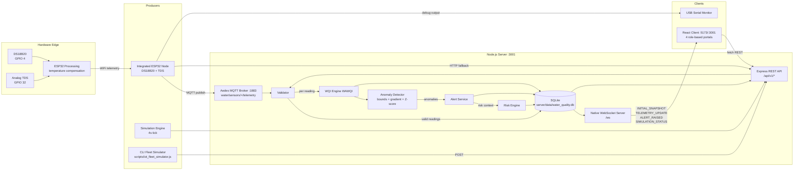
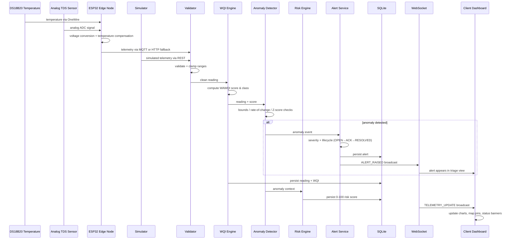
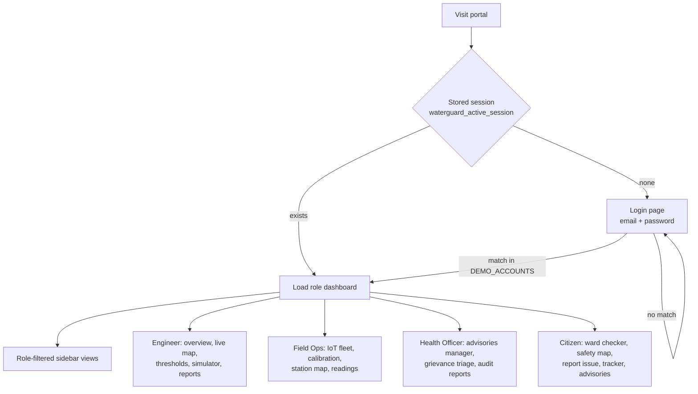
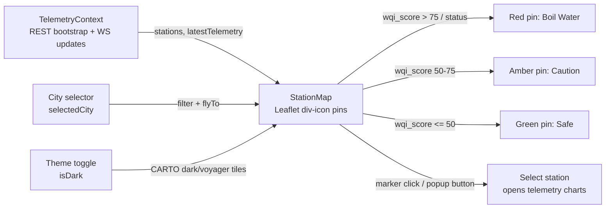

# AquaIntel: Public Water Quality Monitoring & Risk Intelligence Platform

AquaIntel is an end-to-end water quality monitoring platform. Its current integrated ESP32 node reads water temperature with a DS18B20 probe and TDS through an analog sensor interface, applies edge-side processing and temperature compensation, and transmits station telemetry over WiFi. The platform validates and stores time-series data in SQLite, computes the WHO/BIS Weighted Arithmetic Water Quality Index (WAWQI), runs multi-method anomaly detection, scores operational risk, raises alert lifecycles, and serves authority/citizen dashboards in real time over WebSockets.

The internal simulation engine remains available for dashboard development and multi-station demonstrations. It generates realistic telemetry for 21 stations across 4 cities (Trichy, Chennai, Bengaluru, Madurai), so the platform also works out of the box without an ESP32.

---

## Architecture



---

## End-to-End Data Flow



### Integrated ESP32 Hardware Workflow

The current physical telemetry path is:

1. **Measure temperature** — the DS18B20 probe on GPIO 4 returns a digital temperature value over OneWire.
2. **Measure TDS** — the analog TDS interface on GPIO 32 provides an ADC signal to the ESP32.
3. **Process at the edge** — the firmware converts the ADC value to voltage, applies temperature compensation using the DS18B20 reading, calculates TDS, and prepares the station payload.
4. **Transmit** — the ESP32 connects to WiFi and publishes telemetry to `water/sensors/<station_id>/telemetry` using MQTT. HTTP `POST /api/v1/telemetry` is used as a fallback when MQTT is unavailable.
5. **Validate and analyze** — the backend validates the payload, stores the reading, calculates WAWQI and risk context, and checks for anomalies.
6. **Distribute** — the backend broadcasts updates over WebSocket so the role-based dashboards can refresh station cards, charts, maps, and alerts.

The platform-level processing that follows hardware or simulated ingestion is:

1. **Ingestion** — readings arrive via MQTT (`water/sensors/<station_id>/telemetry`), HTTP `POST /api/v1/telemetry`, or the internal simulation engine (4,000 ms tick, adjustable speed).
2. **Validation** — the validator rejects out-of-range/malformed payloads and normalizes units to the canonical schema.
3. **Analytics** — the WQI engine applies per-parameter unit weights (pH 0.22, turbidity 0.25, DO 0.28, TDS 0.15, temp 0.10) against WHO/BIS permissible limits; the anomaly detector combines physical bounds, 5-minute gradient checks, rolling Z-score (window 30, threshold 2.8σ), and multi-parameter correlation.
4. **Risk & alerting** — a composite 0–100 risk score (WQI severity 40%, persistence 25%, source criticality 20%, acute spike 15%) drives alert severity; alerts follow an acknowledge/resolve lifecycle.
5. **Delivery** — every change is broadcast over WebSocket; dashboards re-render charts, GIS pins, and public safety banners instantly.

---

## Authentication & Roles



Access is enforced client-side in `AuthContext.jsx` for this demo build (no server auth). Credentials are baked into the client bundle; the login page does not display or hint them, and only one sign-out entry point (Header) is provided.

Demo accounts:

| Role | Email | Password |
| :--- | :--- | :--- |
| Municipal Engineer | `engineer@waterguard.gov` | `admin123` |
| Field Operations Lead | `fieldops@waterguard.gov` | `field123` |
| Chief Public Health Officer | `health@waterguard.gov` | `health123` |
| Citizen | `citizen@waterguard.org` | `citizen123` |

---

## Live Map Data Flow



Leaflet CSS is bundled locally (no CDN dependency); the map calls `invalidateSize()` on mount, resize, and data refresh so tiles render completely when the view becomes active.

---

## Repository Layout

```
├── client/                 React 18 + Vite + Tailwind dashboard
│   └── src/components/     views/, authority/, citizen/, auth/, layout/
├── server/                 Express + ws + Aedes + SQLite backend
│   ├── src/routes/         REST endpoints (see API table)
│   ├── src/services/       wqiEngine, anomalyDetector, riskEngine,
│   │                       alertService, simulator, validator
│   ├── src/seed/           21 stations + historical series
│   └── test/               node:test suites
├── firmware/               ESP32 C++ sketch, wiring, calibration docs
└── scripts/                iot_fleet_simulator.js, verify_system.js
```

---

## Quickstart

Prerequisites: Node.js v18+ (v22 supported, native `node:sqlite`).

```bash
npm install
npm --prefix server install
npm --prefix client install
```

Start the combined production service (API :3001, MQTT :1883, WebSocket :3001/ws, static client build):

```bash
npm run build:client   # once
npm start
# open http://localhost:3001
```

Hot-reloading development:

```bash
# Terminal 1
npm run server
# Terminal 2
npm run client
# open http://localhost:5173
```

Automated tests (WQI engine, anomaly detector, ingestion pipeline):

```bash
npm test
```

Virtual external device fleet (simulates satellite hardware nodes hitting MQTT/REST):

```bash
npm run simulate:fleet
```

Configuration: all settings have sane defaults in `server/src/config.js` (`PORT=3001`, `MQTT_PORT=1883`, `API_KEY=wq_device_token_demo_2026`) and the client map falls back to keyless CARTO tiles, so no `.env` file is required. To override, set `PORT`, `MQTT_PORT`, `API_KEY`, or (client) `VITE_MAP_API_KEY` + `VITE_MAP_TILE_URL` in the environment.

---

## Running From VS Code and Testing Hardware

### VS Code without an ESP32

You can run the web application entirely from VS Code, but a computer cannot read ESP32 GPIO pins directly. The local dashboard will therefore show readings from the built-in server simulator, not from a physical temperature probe:

```bash
npm install
npm --prefix server install
npm --prefix client install
npm run build:client
npm start
```

Open `http://localhost:3001`. This is sufficient for demonstrating the dashboard, analytics, alerts, and simulated telemetry.

### VS Code with the ESP32 and DS18B20

To see an actual temperature reading, you need an ESP32 board, a DS18B20 probe, a USB data cable, and an Arduino-compatible ESP32 toolchain in VS Code (PlatformIO or the Arduino extension). Install the firmware dependencies `OneWire`, `DallasTemperature`, `PubSubClient`, and the ESP32 board package, then:

1. Wire the DS18B20 to 3.3 V, GND, and GPIO 4, with a 4.7 kΩ pull-up resistor from DATA to 3.3 V. The complete wiring table is in `firmware/docs/WIRING_SCHEMATIC.md`.
2. Set `WIFI_SSID`, `WIFI_PASSWORD`, and `SERVER_HOST` in `firmware/esp32_water_monitor/config.h`. `SERVER_HOST` must be the computer's LAN IP address, not `localhost`.
3. Start the server on the computer with `npm start`, connect the ESP32 and upload `firmware/esp32_water_monitor/esp32_water_monitor.ino`.
4. Open the VS Code serial monitor at **115200 baud**. The firmware requests the DS18B20 temperature every telemetry interval and sends it to the dashboard over MQTT, with HTTP as a fallback.

The current exam-demo firmware keeps the DS18B20 reading real but uses a controlled TDS demonstration path around 134 ppm because the physical TDS transmitter is faulty. pH and turbidity are not currently connected sensors on the integrated node; they are future expansion channels. If the DS18B20 is disconnected, the firmware uses 25 °C as a safety fallback for calculation continuity.

---

## API Reference

| Method | Endpoint | Description |
| :--- | :--- | :--- |
| `GET` | `/api/v1/stations` | List all 21 stations with GPS coordinates |
| `GET` | `/api/v1/stations/:id` | Single station + latest telemetry |
| `GET` | `/api/v1/stations/:id/history` | Historical time-series (limit param) |
| `POST` | `/api/v1/telemetry` | Ingest reading(s); `x-api-key` auth |
| `GET` | `/api/v1/telemetry/latest` | Latest readings across all stations |
| `GET` | `/api/v1/telemetry/anomalies` | Recent detected anomalies |
| `GET` | `/api/v1/alerts` | Alerts (`?active=true` filter) |
| `POST` | `/api/v1/alerts/:id/acknowledge` | Acknowledge alert |
| `POST` | `/api/v1/alerts/:id/resolve` | Resolve alert with notes |
| `GET` | `/api/v1/risk` | 0–100 operational risk scores |
| `GET` | `/api/v1/citizen/overview` | Public safety status + zone data |
| `POST` | `/api/v1/citizen/report` | Submit citizen complaint |
| `GET` | `/api/v1/citizen/reports` | List complaints (triage) |
| `POST` | `/api/v1/citizen/reports/:id/status` | Update complaint status |
| `GET` | `/api/v1/advisories` | Health advisories |
| `POST` | `/api/v1/advisories` | Publish advisory |
| `POST` | `/api/v1/advisories/:id/revoke` | Revoke advisory |
| `GET` | `/api/v1/thresholds` | Get sensor threshold config |
| `POST` | `/api/v1/thresholds` | Update thresholds (engineer only) |
| `GET` | `/api/v1/calibration` | Probe calibration logs |
| `POST` | `/api/v1/calibration` | Record calibration event |
| `GET` | `/api/v1/simulation/status` | Simulator state |
| `POST` | `/api/v1/simulation/start` / `stop` / `speed` | Control simulator |
| `POST` | `/api/v1/simulation/inject` | Inject scenario: `SPILL`, `RUNOFF`, `CHLORINE_DROP`, `RESET` |

WebSocket (`ws://localhost:3001/ws`) message types: `INITIAL_SNAPSHOT`, `TELEMETRY_UPDATE`, `ALERT_RAISED`, `SIMULATION_STATUS`.

---

## IoT Hardware Integration (ESP32)

The integrated hardware node is an ESP32 connected to a DS18B20 temperature probe and an analog TDS sensor. The firmware reads temperature digitally, reads the TDS ADC channel, applies temperature compensation, builds station telemetry, and sends it to the backend over WiFi. It also provides WiFi auto-reconnect, MQTT publishing, HTTP failover, serial diagnostics, and status indication.

| Sensor / component | Signal type | ESP32 pin | Current status |
| :--- | :--- | :--- | :--- |
| Analog TDS | Analog ADC (ADC1_CH4) | GPIO 32 | Integrated hardware input |
| DS18B20 temperature | OneWire | GPIO 4 (4.7 kΩ pull-up) | Integrated hardware input |
| Status LED | Digital out | GPIO 2 | Integrated status indicator |

The firmware uses `OneWire.h` and `DallasTemperature.h` for the DS18B20, `WiFi.h` and `WiFiClient.h` for networking, `PubSubClient.h` for MQTT, and `HTTPClient.h` for the REST fallback. The DS18B20 temperature is used directly in telemetry and as the temperature-compensation input for TDS. TDS is reported in ppm; conductivity is currently derived from TDS as an approximate secondary value.

The physical node publishes to `water/sensors/<station_id>/telemetry`. The REST fallback is `POST /api/v1/telemetry` with header `x-api-key: wq_device_token_demo_2026` (or your `API_KEY`). Wiring and calibration guides: `firmware/docs/WIRING_SCHEMATIC.md`, `firmware/docs/SENSOR_CALIBRATION.md`.

The pH, turbidity, dissolved-oxygen, and direct-conductivity channels are future expansion points. They are represented in parts of the platform schema and analytics model but are not current physical inputs on this ESP32 node.

---

## Standards Reference

- WHO Guidelines for Drinking-Water Quality (4th Edition)
- BIS IS 10500:2012
- Weighted Arithmetic Water Quality Index (Brown et al., 1970)
