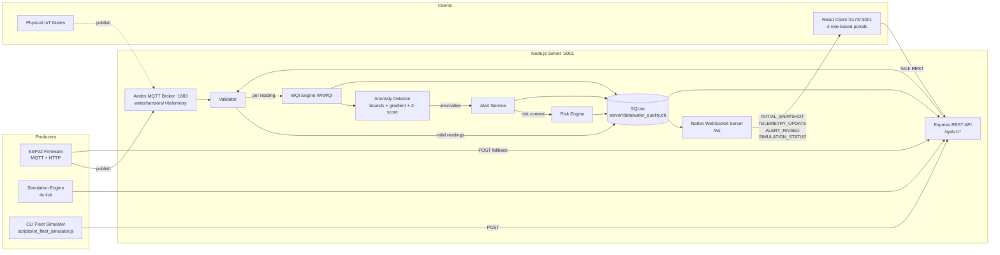
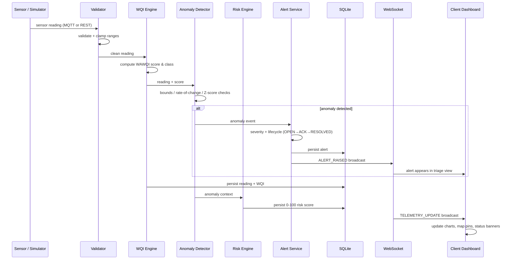
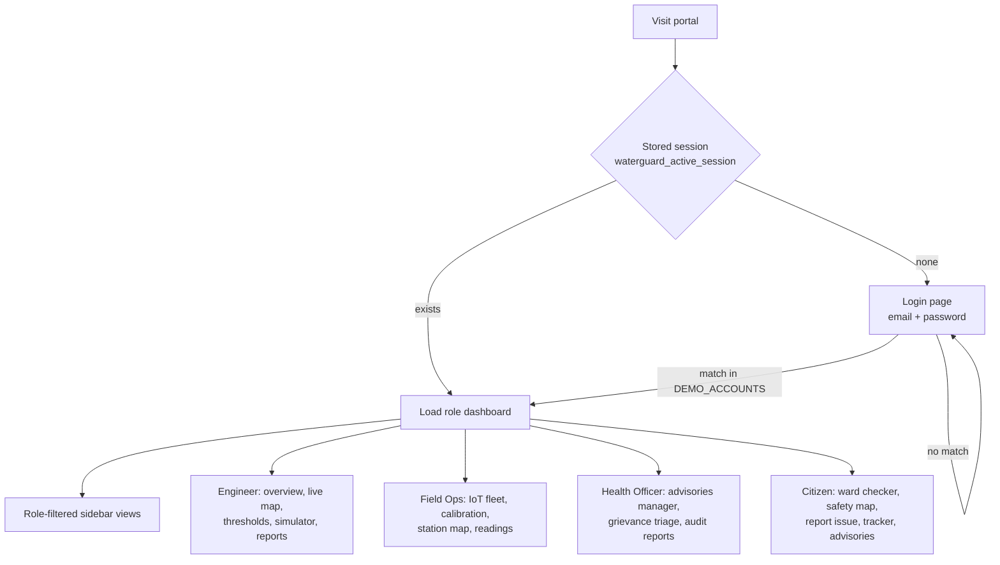
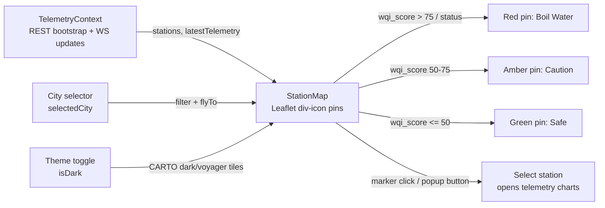

# AquaIntel: Public Water Quality Monitoring & Risk Intelligence Platform

AquaIntel is an end-to-end water quality monitoring platform. It ingests multi-parameter sensor readings from public water sources (rivers, reservoirs, treatment plants, tap networks, community borewells), validates and stores time-series data in SQLite, computes the WHO/BIS Weighted Arithmetic Water Quality Index (WAWQI), runs multi-method anomaly detection, scores operational risk, raises alert lifecycles, and serves dual authority/citizen dashboards in real time over WebSockets.

The demo simulation engine generates realistic telemetry for 21 stations across 4 cities (Trichy, Chennai, Bengaluru, Madurai), so the platform works out of the box with no external services.

---

## Architecture



---

## End-to-End Data Flow



1. **Ingestion** — readings arrive via MQTT (`water/sensors/<station_id>/telemetry`), HTTP `POST /api/v1/telemetry`, or the internal simulation engine (4,000 ms tick, adjustable speed).
2. **Validation** — the validator rejects out-of-range/malformed payloads and normalizes units to the canonical schema.
3. **Analytics** — the WQI engine applies per-parameter unit weights (pH 0.22, turbidity 0.25, DO 0.28, TDS 0.15, temp 0.10) against WHO/BIS permissible limits; the anomaly detector combines physical bounds, 5-minute gradient checks, rolling Z-score (window 30, threshold 2.8σ), and multi-parameter correlation.
4. **Risk & alerting** — a composite 0–100 risk score (WQI severity 40%, persistence 25%, source criticality 20%, acute spike 15%) drives alert severity; alerts follow an acknowledge/resolve lifecycle.
5. **Delivery** — every change is broadcast over WebSocket; dashboards re-render charts, GIS pins, and public safety banners instantly.

---

## Authentication & Roles



Access is enforced client-side in `AuthContext.jsx` for this demo build (no server auth). Credentials are baked into the client bundle; the login page does not display or hint them, and only one sign-out entry point (Header) is provided.

Demo accounts:

| Role | Email | Password |
| :--- | :--- | :--- |
| Municipal Engineer | `engineer@waterguard.gov` | `admin123` |
| Field Operations Lead | `fieldops@waterguard.gov` | `field123` |
| Chief Public Health Officer | `health@waterguard.gov` | `health123` |
| Citizen | `citizen@waterguard.org` | `citizen123` |

---

## Live Map Data Flow



Leaflet CSS is bundled locally (no CDN dependency); the map calls `invalidateSize()` on mount, resize, and data refresh so tiles render completely when the view becomes active.

---

## Repository Layout

```
├── client/                 React 18 + Vite + Tailwind dashboard
│   └── src/components/     views/, authority/, citizen/, auth/, layout/
├── server/                 Express + ws + Aedes + SQLite backend
│   ├── src/routes/         REST endpoints (see API table)
│   ├── src/services/       wqiEngine, anomalyDetector, riskEngine,
│   │                       alertService, simulator, validator
│   ├── src/seed/           21 stations + historical series
│   └── test/               node:test suites
├── firmware/               ESP32 C++ sketch, wiring, calibration docs
└── scripts/                iot_fleet_simulator.js, verify_system.js
```

---

## Quickstart

Prerequisites: Node.js v18+ (v22 supported, native `node:sqlite`).

```bash
npm install
npm --prefix server install
npm --prefix client install
```

Start the combined production service (API :3001, MQTT :1883, WebSocket :3001/ws, static client build):

```bash
npm run build:client   # once
npm start
# open http://localhost:3001
```

Hot-reloading development:

```bash
# Terminal 1
npm run server
# Terminal 2
npm run client
# open http://localhost:5173
```

Automated tests (WQI engine, anomaly detector, ingestion pipeline):

```bash
npm test
```

Virtual external device fleet (simulates satellite hardware nodes hitting MQTT/REST):

```bash
npm run simulate:fleet
```

Configuration: all settings have sane defaults in `server/src/config.js` (`PORT=3001`, `MQTT_PORT=1883`, `API_KEY=wq_device_token_demo_2026`) and the client map falls back to keyless CARTO tiles, so no `.env` file is required. To override, set `PORT`, `MQTT_PORT`, `API_KEY`, or (client) `VITE_MAP_API_KEY` + `VITE_MAP_TILE_URL` in the environment.

---

## API Reference

| Method | Endpoint | Description |
| :--- | :--- | :--- |
| `GET` | `/api/v1/stations` | List all 21 stations with GPS coordinates |
| `GET` | `/api/v1/stations/:id` | Single station + latest telemetry |
| `GET` | `/api/v1/stations/:id/history` | Historical time-series (limit param) |
| `POST` | `/api/v1/telemetry` | Ingest reading(s); `x-api-key` auth |
| `GET` | `/api/v1/telemetry/latest` | Latest readings across all stations |
| `GET` | `/api/v1/telemetry/anomalies` | Recent detected anomalies |
| `GET` | `/api/v1/alerts` | Alerts (`?active=true` filter) |
| `POST` | `/api/v1/alerts/:id/acknowledge` | Acknowledge alert |
| `POST` | `/api/v1/alerts/:id/resolve` | Resolve alert with notes |
| `GET` | `/api/v1/risk` | 0–100 operational risk scores |
| `GET` | `/api/v1/citizen/overview` | Public safety status + zone data |
| `POST` | `/api/v1/citizen/report` | Submit citizen complaint |
| `GET` | `/api/v1/citizen/reports` | List complaints (triage) |
| `POST` | `/api/v1/citizen/reports/:id/status` | Update complaint status |
| `GET` | `/api/v1/advisories` | Health advisories |
| `POST` | `/api/v1/advisories` | Publish advisory |
| `POST` | `/api/v1/advisories/:id/revoke` | Revoke advisory |
| `GET` | `/api/v1/thresholds` | Get sensor threshold config |
| `POST` | `/api/v1/thresholds` | Update thresholds (engineer only) |
| `GET` | `/api/v1/calibration` | Probe calibration logs |
| `POST` | `/api/v1/calibration` | Record calibration event |
| `GET` | `/api/v1/simulation/status` | Simulator state |
| `POST` | `/api/v1/simulation/start` / `stop` / `speed` | Control simulator |
| `POST` | `/api/v1/simulation/inject` | Inject scenario: `SPILL`, `RUNOFF`, `CHLORINE_DROP`, `RESET` |

WebSocket (`ws://localhost:3001/ws`) message types: `INITIAL_SNAPSHOT`, `TELEMETRY_UPDATE`, `ALERT_RAISED`, `SIMULATION_STATUS`.

---

## IoT Hardware Integration (ESP32)

Firmware: `firmware/esp32_water_monitor/` — moving-average filtering, temperature compensation, WiFi auto-reconnect, dual MQTT/HTTP failover.

| Sensor | Signal Type | ESP32 Pin |
| :--- | :--- | :--- |
| Analog pH probe | Analog (0–3.3 V) | GPIO 34 (ADC1_CH6) |
| DFRobot turbidity | Analog (0–3.3 V) | GPIO 35 (ADC1_CH7) |
| Analog TDS | Analog (0–2.3 V) | GPIO 32 (ADC1_CH4) |
| DS18B20 temperature | OneWire | GPIO 4 (4.7 kΩ pull-up) |
| Status LED | Digital out | GPIO 2 |

Telemetry topic: `water/sensors/<station_id>/telemetry` · REST fallback: `POST /api/v1/telemetry` with header `x-api-key: wq_device_token_demo_2026` (or your `API_KEY`). Wiring and calibration guides: `firmware/docs/WIRING_SCHEMATIC.md`, `firmware/docs/SENSOR_CALIBRATION.md`.

---

## Standards Reference

- WHO Guidelines for Drinking-Water Quality (4th Edition)
- BIS IS 10500:2012
- Weighted Arithmetic Water Quality Index (Brown et al., 1970)
